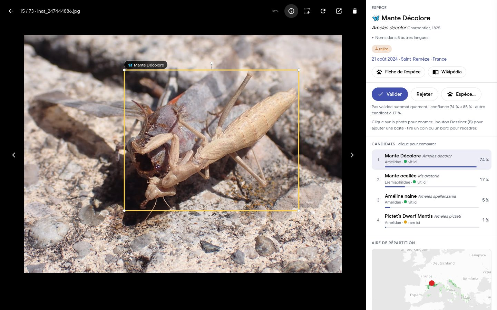
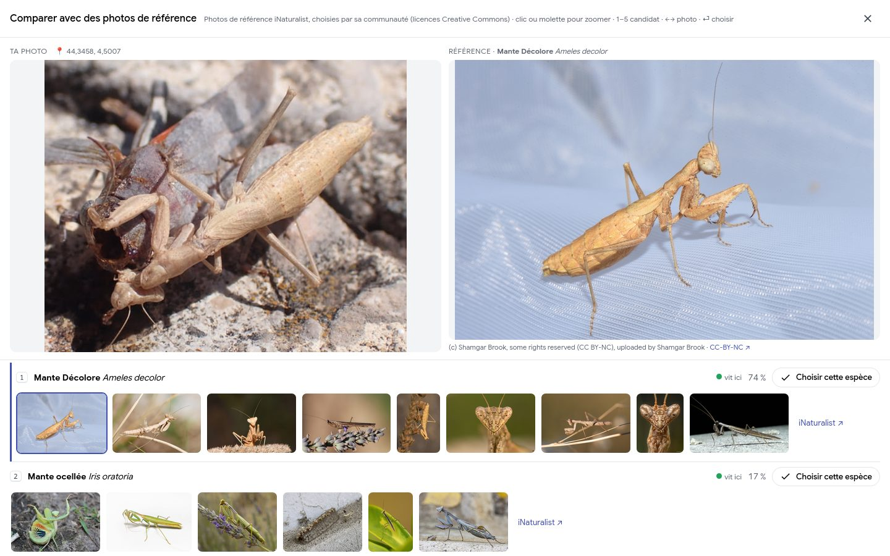
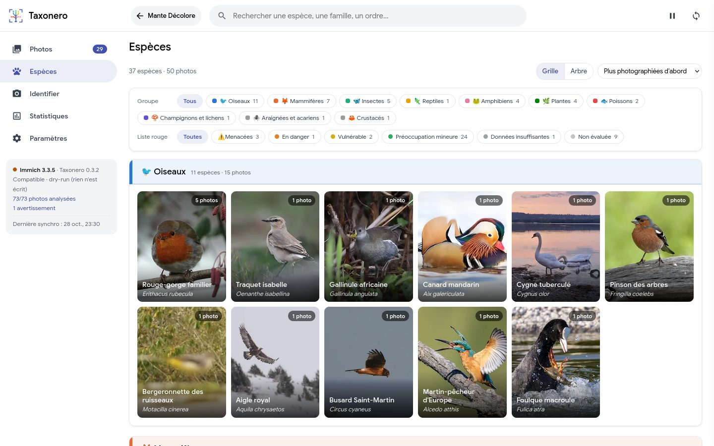
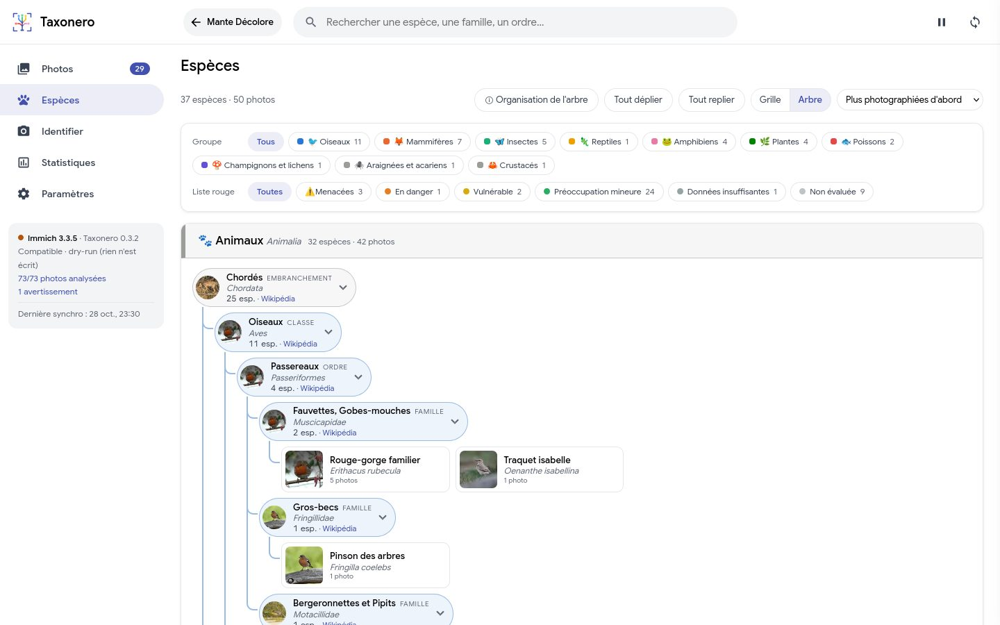
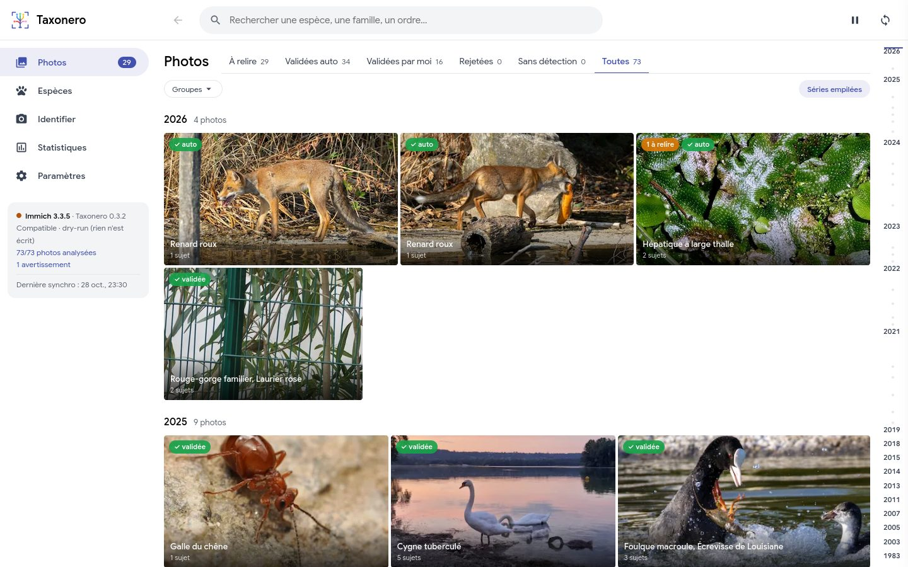
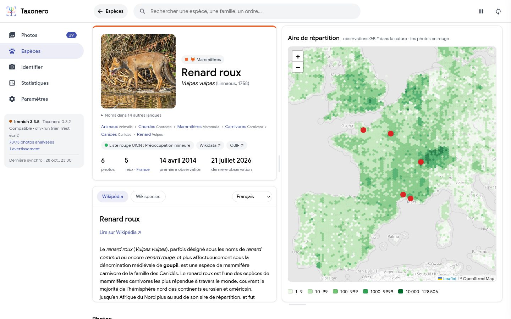
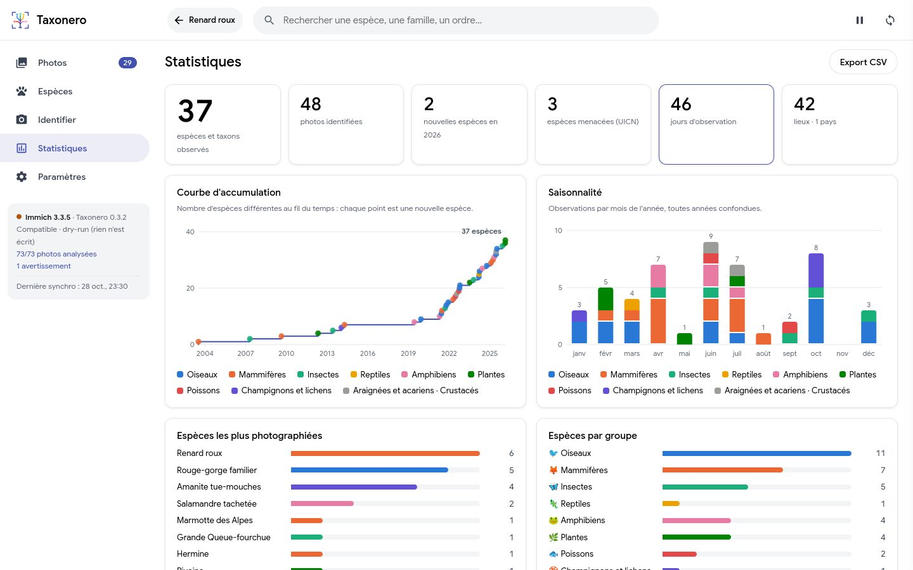

<p align="center"></p>

# Taxonero

[English](README.md) · **Français**

Identification des espèces dans tes photos par IA, auto-hébergée (oiseaux, mammifères, reptiles, amphibiens,
insectes, araignées, poissons, plantes, champignons et lichens) : une photothèque [Immich](https://immich.app), un
dossier local ou un logiciel photo (darktable, Lightroom Classic, RawTherapee, RapidRAW, Apple Photos), ou
plusieurs à la fois. **Tes photos ne sont jamais modifiées.**

<table>
<tr>
<td width="50%"><a href="docs/screenshots/fr/viewer.jpg"></a><br><sub>Visionneuse : sujet, candidats et aire de répartition</sub></td>
<td width="50%"><a href="docs/screenshots/fr/compare.jpg"></a><br><sub>Comparaison avec des photos de référence</sub></td>
</tr>
<tr>
<td width="50%"><a href="docs/screenshots/fr/species.jpg"></a><br><sub>Espèces, vue Grille par groupe</sub></td>
<td width="50%"><a href="docs/screenshots/fr/tree.jpg"> embranchement > classe > ordre > famille > espèce"></a><br><sub>Espèces, vue Arbre : règne > embranchement > classe > ordre > famille > espèce</sub></td>
</tr>
<tr>
<td width="50%"><a href="docs/screenshots/fr/photos.jpg"></a><br><sub>Photos, avec filtres par état et par groupe</sub></td>
<td width="50%"><a href="docs/screenshots/fr/species-page.jpg"></a><br><sub>Fiche d'une espèce : carte et article</sub></td>
</tr>
<tr>
<td colspan="2" align="center"><a href="docs/screenshots/fr/stats.jpg"></a><br><sub>Statistiques</sub></td>
</tr>
</table>

<sub>Photos de test : auteurs et licences dans [docs/screenshots/CREDITS.md](docs/screenshots/CREDITS.md).</sub>

- Détection des sujets dans l'image (rectangles), identification de l'espèce, vérification
  géographique (l'espèce vit-elle là où la photo a été prise ?).
- Photos et **vidéos** (l'image clé de chaque vidéo, choisie par Immich, est analysée comme une photo).
- Auto-validation des cas sûrs : forte confiance, espèce observée à proximité, aucun autre candidat crédible,
  et jamais dans un groupe où le modèle se trompe souvent (araignées, poissons, puis selon tes relectures).
- Animaux domestiques (chiens, chats, chevaux, bétail, poules) écartés par défaut, pour ne pas remplir
  l'arbre du vivant avec les photos de famille.
- Tout ce que le dashboard affiche (fiches, noms, aires de répartition, articles) est mis en local par la
  synchronisation : la relecture n'attend pas le réseau. Bouton « Synchroniser » = nouvelles photos
  d'Immich, analyse, tags et mise à jour des données locales, avec progression.
- Analyse en deux phases qui tournent en même temps, chacune avec sa barre : la partie IA (détection,
  identification) parcourt la file à pleine vitesse du GPU pendant que la vérification géographique (GBIF)
  suit sur ses résultats ; le GPU est libéré dès que la partie IA est finie. La présence
  autour d'un point coûte une requête GBIF par zone de 1° pour toutes les espèces à la fois (gardée
  180 jours), et non une par candidat.
- Dashboard au style d'Immich (mêmes couleurs, police, barre latérale) : page Photos avec onglets d'état
  (à relire, validées auto, validées par moi, rejetées, sans détection) et menu Groupes (animaux, plantes,
  champignons, chacun avec ses groupes : oiseaux, mammifères…, plusieurs à la fois), et visionneuse plein écran
  pilotable au clavier, rectangles cliquables qui ouvrent l'article Wikipédia ou
  Wikispecies dans un panneau latéral, noms communs en 15 langues, boîtes dessinées à la main,
  page Espèces (vue Grille par groupe, ou vue Arbre de toutes les branches, règne > embranchement > classe > ordre > famille > espèce ; filtres par groupe et Liste rouge UICN),
  **page dédiée à chaque espèce** (photo principale au choix, avec l'étoile sur ses photos ; noms, taxonomie,
  aire de répartition GBIF avec tes
  observations, article Wikipédia / Wikispecies), **page pour chaque rang supérieur** (règne, embranchement, classe, ordre, famille, genre : ses espèces,
  carte de répartition, article), depuis la classification d'une espèce, la vue Arbre ou l'en-tête d'un groupe, statistiques (courbe d'accumulation,
  saisonnalité, carte de toutes les observations, pays, Liste rouge, matériel, bilan de la relecture), export CSV.
- Barre de recherche avec suggestions pendant la frappe : espèces et rangs, noms communs de toutes les langues
  et noms scientifiques, sans tenir compte des accents ; flèches et Entrée pour ouvrir.
- **Séries (rafales)** : photos du même appareil prises à moins de 2 min d'intervalle (et à moins de 1 km),
  10 min au plus de la première à la dernière (une longue balade n'est pas une rafale).
  Dans la grille, une tuile « ×N » par série (réglage « Séries empilées ») : la sélectionner prend toute la série.
  Les détections à relire sont lissées comme le fait le post-traitement de MegaDetector : une espèce isolée prend
  l'espèce proposée sur au moins 4 photos de la série, si elle figure parmi ses candidats avec au moins le quart de
  la probabilité de sa propre proposition (un modèle sûr de lui n'est pas contredit par un candidat marginal) ; un genre, une famille
  ou un ordre est précisé par l'espèce de la série qu'il contient (au moins 2 photos). La visionneuse l'indique
  (« proposé par la série ; le modèle proposait … »). Les photos d'une rafale se ressemblent et répètent souvent
  la même erreur : le lissage corrige les incohérences sans rendre la validation automatique plus permissive.
- **Lieu indiqué à la main** pour les photos sans GPS (appareil sans GPS, scans) : un clic sur la carte depuis
  la visionneuse, ou pour toute une sélection (bouton « Lieu… »), avec « même lieu que la dernière fois ». Les
  détections à relire sont reclassées aussitôt avec ce lieu ; un vrai GPS n'est jamais remplacé.
- **Comparaison en images** (visionneuse et page Identifier) : le sujet à côté des photos de référence de
  chaque candidat, celles qu'iNaturalist met en avant sur la fiche du taxon (licences Creative Commons,
  auteur affiché, images chargées depuis iNaturalist).
  Le lieu de la photo est affiché, avec un bouton pour l'indiquer s'il manque, et chaque candidat indique s'il vit
  dans la région. Au clavier : `1`-`5` candidat, `←` `→` photo de référence, `⏎` choisir l'espèce.
- Page **Identifier** : une image déposée (ou collée) est identifiée sans être gardée, avec sa carte de
  répartition et l'article Wikipédia.
- Relecture rapide : passage automatique à la photo suivante, sélection de plusieurs photos
  (coche sur la photo, appui long au doigt, Ctrl/Maj + clic, glisser à la souris, un mois entier, toutes celles du
  filtre, ou l'inverse de la sélection), partout où il y a des photos, y compris les fiches d'une espèce ou d'un rang,
  pour valider, rejeter, donner une même espèce, indiquer un lieu, remettre à relire, ré-analyser, supprimer ou
  exporter en CSV en lot ; bouton **Retour** dans la barre du haut, qui suit le parcours et retrouve le filtre, la
  position et la photo ouverte ; date, lieu, appareil et chiffres cliquables ; annulation (U) valable toute la session ; frise de défilement par dates comme dans Immich (survol : le mois ; clic ou glisser : on y va ; en remontant après un saut, les photos plus récentes se chargent seules), bouton pause de l'analyse par l'IA (libère le processeur et la mémoire, gardé au redémarrage), flèches du clavier dans la grille ; zoom dans la visionneuse (molette, clic, pincement, Z sur le sujet sélectionné), et pour une **série**
  (rafale : même appareil, photos à moins de 2 min d'intervalle) le même taxon validé d'un clic sur les
  autres photos où il est proposé. Filtres par groupe, tri des plus sûres ou des plus douteuses d'abord,
  et pour chaque détection à relire la raison pour laquelle elle n'a pas été validée automatiquement.
- Interface en 12 langues (français, anglais, allemand, espagnol, italien, néerlandais, portugais, catalan,
  polonais, suédois, japonais, chinois), choisie dans **Paramètres > Général** : la même langue sert pour
  les noms communs des espèces et les articles Wikipédia. Le breton, le basque et l'occitan sont proposés
  pour les noms d'espèces, avec l'interface en français. Les tags écrits dans Immich suivent `NAMES_LANG`.
- Dans la fiche de relecture, une mini-carte montre l'aire du candidat et le lieu de la photo ;
  survoler un autre candidat affiche son aire, pour juger tout de suite de sa plausibilité.
- Écriture dans Immich de **tags hiérarchiques** (`Nature/Aves/Passeriformes/Paridae/Parus/Mésange charbonnière (Parus major)`)
  et d'un bloc dans la description (nom + lien Wikipédia), uniquement pour les détections validées.

Inspiré de [Specio](https://specio.life), en libre et auto-hébergé. Taxonero est un projet indépendant, sans
lien avec Immich. Le nom vient de *taxon*, un groupe du vivant (espèce, genre, famille…).

## Principes de sécurité

L'outil est un service séparé qui ne parle à Immich que par son API publique.

| Garantie | Comment |
|---|---|
| Aucun accès à la base, aux fichiers ou aux conteneurs d'Immich | Service Docker distinct, API uniquement |
| Pas de suppression de photo possible | Clé API limitée à 8 permissions, sans `asset.delete` ni `asset.upload` ; une permission manquante passe l'outil en lecture seule, une permission en trop (ou « all ») est signalée |
| Clé API protégée | Jamais renvoyée au navigateur (seulement ses 4 derniers caractères) ; enregistrée dans `data/` (ou dans `.env`), absente des sauvegardes quotidiennes |
| Aucune requête hors liste | Contrat d'API figé (`immich/contract.py`) : toute autre requête est refusée avant envoi |
| Une mise à jour d'Immich ne casse rien | Au démarrage, la spec OpenAPI du serveur est comparée au contrat ; au moindre écart bloquant, passage en **lecture seule** |
| Rien n'est écrit par défaut | `DRY_RUN=true` par défaut |
| Tes tags et ton texte sont intouchables | L'outil ne retire que ce qu'il a posé lui-même (tracé en base) ; dans la description, seul le bloc `⟦nature⟧…⟦/nature⟧` lui appartient |
| Tout est réversible | **Paramètres > Source des photos > Annuler ce qui a été écrit dans Immich** (ou `taxonero uninstall --apply`) retire exactement ce qui a été écrit, puis suspend les écritures jusqu'à ce que tu les reprennes ; un tag créé par l'outil et devenu vide (espèce corrigée) est supprimé, sauf si tu l'as réutilisé |
| Dashboard protégé | Mot de passe (HTTP Basic), limite d'essais par adresse IP et refus des requêtes d'écriture venant d'un autre site (CSRF) ; polices et bibliothèques servies en local. HTTP Basic n'est pas chiffré : hors réseau de confiance, passer par un proxy TLS et régler `FORWARDED_ALLOW_IPS` (voir `.env.example`) |
| Photo supprimée dans Immich | Masquée dans le dashboard (relectures conservées si elle revient de la corbeille), plus jamais synchronisée |
| Photo que tu viens de modifier | Non touchée pendant 10 min (voir « Limites connues ») |

## Modèles

| Étape | Modèle | Licence |
|---|---|---|
| Détection faune | [MegaDetector v6](https://github.com/microsoft/Pytorch-Wildlife), variante RT-DETR `MDV6-apa-rtdetr-e` | Apache 2.0 |
| Détection flore, fonge, petits animaux | [OWLv2](https://huggingface.co/google/owlv2-base-patch16-ensemble) (vocabulaire ouvert : « a flower », « a mushroom », « an insect »…) | Apache 2.0 |
| Identification | [BioCLIP 2](https://huggingface.co/imageomics/bioclip-2) (ViT-L/14, TreeOfLife-200M, ~950 000 taxons) | MIT |
| Taxonomie, noms, UICN, occurrences | [GBIF](https://www.gbif.org/developer/summary) | données CC0 / CC-BY |
| Noms multilingues, liens Wikipédia et Wikispecies | Wikidata (propriété P846, identifiant GBIF) | CC0 |
| Aires de répartition | [API cartes GBIF](https://techdocs.gbif.org/en/openapi/v2/maps) : tuiles vectorielles lues une fois sur une grille hexagonale fixe (~25 km en Europe pour une espèce ou un genre, ~50 km pour les rangs supérieurs), recalée sur la grille exacte de GBIF pour que les cases s'emboîtent ; en zoomant, la tuile du zoom affiché est demandée à la volée (cases de ~11 px à l'écran, gardées 30 jours, grille locale en repli) ; observations de terrain seulement, sur un fond de carte presque blanc | CC0 / CC-BY |
| Photos de référence (comparaison) | [API iNaturalist](https://api.inaturalist.org/v1/docs/) : photos mises en avant sur la fiche du taxon, licences Creative Commons seulement | CC0 / CC BY / CC BY-NC… (selon la photo) |
| Articles du panneau latéral | API Wikipédia / Wikispecies (TextExtracts), texte nettoyé (liste blanche de balises) | CC BY-SA |

MegaDetector tourne dans PyTorch, comme OWLv2 et BioCLIP, donc sur le même GPU quel qu'il soit. Ses poids
officiels sont téléchargés au premier lancement là où l'amont les publie ([Zenodo](https://zenodo.org/records/15398270),
CC-BY 4.0, empreinte vérifiée), comme le fait PytorchWildlife ; le code du modèle (RT-DETRv2, Apache 2.0) est repris
dans `src/taxonero/rtdetr` (voir `NOTICE`), sans PytorchWildlife ni ultralytics (AGPL). Mêmes résultats que la
version ONNX utilisée jusqu'ici : 112 boîtes sur 112 identiques sur les photos de dev, écart de score ≤ 0,00002.
Un fichier ONNX fourni par `DETECTOR_PATH` reste utilisé s'il existe.

### Résultats mesurés

Jeu de test : 73 observations iNaturalist françaises (qualité recherche, CC0/CC-BY), tous groupes
confondus, volontairement difficile (espèces rares, araignées, lichens). Script :
`dev/benchmark_pipeline.py`. Échantillon petit : à prendre comme ordre de grandeur.

Pipeline complet (MegaDetector + OWLv2, BioCLIP 2, filtre géographique GBIF, dédoublonnage),
mesuré sur le dashboard de dev (`dev/benchmark_e2e.py` pour le refaire) :

| Mesure | Résultat |
|---|---|
| Espèce exacte (décision finale) | **53/73 (73 %)**, OWLv2 sur chaque photo ; quand l'outil ne tranche pas l'espèce, il propose le genre ou la famille |
| Par groupe | oiseaux 16/18, mammifères 10/13, insectes 6/8, amphibiens 6/8, champignons et lichens 8/10, plantes 4/6, reptiles 2/4, poissons 1/3, araignées 0/3 |
| Auto-validation (règle par défaut) | 39 détections validées sans relecture, 35 justes ; 3 des 4 écarts sont des étiquettes discutables (busard *hudsonius*/*cyaneus*, champignon parasite d'une hépatique, sous-espèce de renard), le 4e une salamandre prise pour un houx |
| Effet du filtre géographique | +15 points sur l'espèce juste (BioCLIP seul : 59 % en tête de liste, 74 % avec GBIF) |
| Vitesse | ~6 s/photo sur le CPU d'un portable (OWLv2 en repli), ~19 s avec OWLv2 sur chaque photo ; bien moins d'une seconde attendue sur GPU |

Le jeu est petit et difficile : ce sont des ordres de grandeur, pas une garantie.

## Installation

Prérequis : Immich v3 (testé sur 3.3.5), et Docker ou l'édition de bureau (sans Docker). GPU conseillé (prévu
pour une RTX 3060 12 Go) ; fonctionne aussi sur processeur, beaucoup plus lentement.

Trois façons de l'installer : **image Docker** toute faite (serveur Linux, NAS), **TrueNAS SCALE** (même image),
ou **édition de bureau** (Windows, macOS, Linux : un petit lanceur qui installe le reste).

### État des tests

Projet personnel testé avec le matériel disponible : le reste est prévu dans le code mais n'a jamais tourné.
Retours bienvenus (issue GitHub, avec ce qu'affiche **Paramètres > Modèles d'IA**).

| Installation | Matériel | État |
|---|---|---|
| Docker, Linux x86 | processeur | testé (Fedora, Podman) |
| Docker, Linux x86 | NVIDIA, image `cuda13` | en service sur TrueNAS SCALE avec une RTX 3060 |
| Docker, Linux x86 | NVIDIA, image `cuda12` | non testé |
| Docker, Linux x86 | AMD, image `rocm` | non testé |
| Docker, Linux x86 | Intel Arc / Core Ultra, image `xpu` | non testé ; sur Iris Xe (non pris en charge par PyTorch), repli sur le processeur vérifié |
| Docker, Linux ARM (Raspberry Pi 5, NAS ARM) | processeur | non testé (image construite par émulation) |
| Docker Desktop, macOS ou Windows | processeur | non testé |
| Bureau, Linux x86 | processeur | testé (Fedora) ; .deb, .rpm et AppImage : installation et premier lancement vérifiés |
| Bureau, Linux | NVIDIA, AMD, Intel | non testé |
| Bureau, Windows 11 x86 | NVIDIA (RTX 4070) | testé, fonctionne |
| Bureau, Windows | processeur, AMD, Intel ; ARM | non testé |
| Bureau, macOS (Apple Silicon) | GPU Apple (Metal) | fonctionne sur un Mac M4 d'après un utilisateur (pas vérifié par moi) |

Un GPU qui se déclare disponible mais plante au premier calcul ne bloque rien : au démarrage, un petit calcul
d'essai tourne dans un processus séparé, et s'il échoue l'analyse se fait sur le processeur (raison affichée dans
**Paramètres > Modèles d'IA**). Sur Mac, une opération que le GPU Apple ne sait pas faire passe sur le processeur
(`PYTORCH_ENABLE_MPS_FALLBACK`).

### Matériel de calcul

Par défaut, l'IA tourne sur le GPU s'il y en a un d'utilisable, sinon sur le processeur ; le choix se
change dans **Paramètres > Analyse > Calcul** (GPU ou processeur, modèles rechargés à la prochaine analyse) ou avec
`DEVICE` (`auto`, `cpu`, ou précisément `cuda`, `xpu`, `mps`). Un GPU demandé mais absent fait repasser
sur le processeur au lieu d'arrêter l'analyse.

**OWLv2** (plantes, champignons, insectes) est le modèle le plus lent sur processeur. **Paramètres > Analyse > Calcul**
(ou `OPEN_DETECTOR_MODE`) le fait tourner sur chaque photo (`always`) ou seulement quand MegaDetector ne
trouve aucun animal (`fallback`). En `auto` (défaut) : `always` avec un GPU, `fallback` sur processeur.
Mesures sur processeur (portable, 73 photos de `dev/photos`, `dev/benchmark_e2e.py`) :

| OWLv2 | Temps par photo | Espèce juste | Validation automatique |
|---|---|---|---|
| `always` | 18,6 s | 72,6 % | 39 détections, 89,7 % justes |
| `fallback` | 6,3 s | 71,2 % (une plante de moins) | identique |

Sur 12 photos d'animaux domestiques, `fallback` en reconnaît 5 comme domestiques au lieu de 7 : deux de
plus restent à relire. La quantification int8 a aussi été mesurée et écartée : 5,5 points de justesse
perdus pour un gain de temps négligeable sur la photo entière.

Mémoire : les empreintes de texte de BioCLIP (2,7 Go) sont lues en mmap, donc récupérables par le système
sous pression mémoire, et la partie texte du modèle, inutile une fois ces empreintes calculées, est libérée.
Les résultats sont identiques au bit près. `MEM_LIMIT` (8 Go par défaut) borne le conteneur.

Sur GPU, les photos sont analysées par lots (taille automatique selon la mémoire du GPU, 8 pour 12 Go et 16 pour
24 Go, divisée par deux toute seule si la mémoire sature ; ou fixée par `GPU_BATCH` ou **Paramètres > Analyse >
Calcul**). MegaDetector et OWLv2 (deux fois moins à la fois) traitent chaque lot en un passage, et tous leurs
recadrages sont identifiés en un seul passage de BioCLIP ; le nombre d'aperçus téléchargés à l'avance suit la
taille des lots, et ils se téléchargent pendant le calcul. Résultats identiques à
l'analyse photo par photo ; sur processeur, grouper n'apporte rien et les photos passent une à une.

Les modèles quittent la mémoire du GPU après 5 minutes sans analyse et sont rechargés à la suivante (`MODELS_IDLE_MINUTES`
ou **Paramètres > Analyse > Calcul** ; 0 : toujours gardés). Le processus garde son contexte CUDA, une petite partie de
la mémoire reste donc occupée jusqu'à son arrêt.

Les résultats sont les mêmes sur GPU et sur processeur : tout est calculé en float32 complet. Les GPU
NVIDIA récents utilisent par défaut TF32 (précision réduite) dans cuDNN et dans le CUDA d'ONNX Runtime ;
l'outil le désactive. `dev/compare_devices.py` compare les deux sur un lot de photos (à lancer sur la
machine qui a le GPU). La page
**Paramètres > Modèles d'IA** affiche ce qui tourne réellement (GPU, mémoire, moteur de chaque modèle,
vitesse mesurée).

Le matériel de la machine se règle avec `GPU=` dans `.env`, que `./detect-gpu.sh` remplit tout seul : la
variable choisit à la fois l'image (`ghcr.io/adn-dan/taxonero:latest-<GPU>`) et l'accès au matériel
(`hwaccel.yml`, même principe que `hwaccel.ml.yml` d'Immich). Le même `docker compose up -d` marche donc sur toutes
les machines.

| `GPU=` | Matériel | Taille de l'image | Remarques |
|---|---|---|---|
| `cuda13` | NVIDIA, pilote ≥ 580 | ~7 Go | torch 2.14 (CUDA 13) |
| `cuda12` | NVIDIA, pilote ≥ 525 | ~7 Go (estimée) | torch 2.11 (CUDA 12.8) |
| `rocm` | AMD (ROCm 7.2) | plus de 15 Go | non testé |
| `xpu` | Intel Arc (cartes A et B), Core Ultra | ~8 Go | non testé ; pilote GPU d'Intel inclus ; Iris Xe, UHD et plus anciens : non pris en charge par PyTorch |
| `cpu` (défaut) | sans GPU, x86 et ARM | ~2 Go | |

Un GPU NVIDIA demande le NVIDIA Container Toolkit sur l'hôte (le script prévient s'il semble absent). AMD et
Intel : le conteneur ne tourne pas en root, il reçoit le groupe propriétaire de `/dev/dri/renderD*`
(`RENDER_GID`, écrit par le script).

Les trois modèles tournent dans PyTorch : le GPU choisi sert à tous (plus de version d'ONNX Runtime à accorder).

### Docker (toute machine Linux, Unraid, Synology, Portainer…)

1. Récupérer le dépôt (`git clone`, ou l'archive de la dernière version), puis `./detect-gpu.sh` : crée `.env`
   depuis `.env.example` et y écrit le matériel détecté (`GPU=`). Renseigner `DASHBOARD_PASSWORD` et `TZ` dans `.env`.
2. `docker compose up -d` : télécharge l'image pour ce matériel, puis la démarre. À la première analyse, ~5 Go
   de modèles sont téléchargés dans `./data`.
3. Ouvrir `http://<serveur>:8765` (utilisateur `nature`). Au premier lancement, le dashboard ouvre
   **Paramètres > Source des photos > Immich** : l'adresse d'Immich vue depuis le conteneur, et une clé API. L'adresse est celle
   de la machine avec le port publié d'Immich (`http://192.168.1.10:2283`), ou `http://immich-server:2283`
   après avoir rejoint le réseau Docker d'Immich (lignes commentées à la fin de `docker-compose.yml`).
   La clé se crée dans Immich, **Paramètres du compte > Clés API > Nouvelle clé**, en cochant uniquement
   `asset.read`, `asset.update`, `asset.view`, `server.about`, `tag.asset`, `tag.create`, `tag.delete`,
   `tag.read` (liste copiable depuis le dashboard). Facultatif : `asset.download` (lecture seule) pour
   identifier les petits sujets sur l'original en pleine résolution plutôt que sur l'aperçu (1440 px sur le
   petit côté), et pour zoomer en pleine définition dans la visionneuse. **Tester** dit ce qui ne va pas (adresse injoignable, clé refusée, permission manquante ou en
   trop) ; **Enregistrer** n'enregistre qu'une connexion qui fonctionne. Pas de compte ni de mot de passe
   Immich : l'outil ne voit que les photos du compte qui a créé la clé. Variante : `IMMICH_URL` et
   `IMMICH_API_KEY` dans `.env` (elles priment et sont alors verrouillées dans le dashboard).
4. **Paramètres > Modèles d'IA** montre ce qui tourne vraiment (GPU, moteurs). Relire quelques dizaines de
   détections.
5. Quand le résultat convient : `DRY_RUN=false`, puis `docker compose up -d`.

Mise à jour : `docker compose pull && docker compose up -d` (`VERSION=0.1.0` dans `.env` fige une version au lieu
de suivre `latest`).

Construire l'image soi-même (code modifié, pas d'accès à GHCR) : `docker compose -f docker-compose.yml -f
docker-compose.build.yml up -d --build` (15 à 30 min la première fois).

Portainer (ou Unraid, Synology) : une *Stack* depuis le dépôt avec `docker-compose.yml` et `hwaccel.yml`, et les
variables de `.env.example`. Podman : `podman compose` fonctionne pareil ; pour un GPU NVIDIA, Podman passe par CDI
(`devices: [nvidia.com/gpu=all]` à la place du bloc `deploy` de `hwaccel.yml`). Docker Desktop sur macOS : pas
d'accès au GPU Apple depuis un conteneur, l'analyse se fait sur le processeur (le GPU Apple sert avec l'édition de
bureau).

### TrueNAS SCALE

L'app s'installe avec un fichier YAML tout prêt, qui utilise l'image de GHCR.

1. GPU : **Apps > Configuration > Settings**, cocher *Install NVIDIA Drivers* (et ne pas isoler la carte pour
   une VM).
2. Créer le dossier de données au nom de l'utilisateur des apps, dans le shell de TrueNAS (**System > Shell**) :
   `sudo mkdir -p /mnt/POOL/apps/taxonero/data && sudo chown 568:568 /mnt/POOL/apps/taxonero/data`.
3. Pilote NVIDIA (`nvidia-smi`) : à partir de 580, image `latest-cuda13` ; sinon `latest-cuda12` ; sans GPU,
   `latest-cpu` et retirer le bloc `deploy`.
4. **Apps > Discover Apps > ⋮ > Install via YAML** : coller [`deploy/truenas/taxonero.yaml`](deploy/truenas/taxonero.yaml),
   après y avoir mis l'image, le pool et le mot de passe.
5. Ouvrir `http://<nas>:8765`, puis **Paramètres > Source des photos > Immich** : l'adresse du NAS et le port de l'app Immich
   (`http://192.168.1.10:30041` par défaut) et une clé API (étape 3 de l'installation Docker). Les apps
   TrueNAS ne partagent pas de réseau, d'où l'adresse du NAS plutôt qu'un nom de conteneur.
6. **Paramètres > Modèles d'IA** doit montrer le GPU, et MegaDetector sur « GPU NVIDIA (CUDA) ».

Mise à jour : **Apps > taxonero > Edit**, puis *Save* sans rien changer : le YAML demande de retélécharger
l'image à chaque déploiement (`pull_policy: always`), donc la dernière version `latest`.
Construire l'image sur le NAS à la place : copier les sources, `sudo sh deploy/truenas/build.sh
/mnt/POOL/apps/taxonero/data`, puis dans le YAML `image: taxonero:<variante>` et `pull_policy: never`.

Fiche de l'app (logo, version, liens) : TrueNAS donne à une app personnalisée une fiche générique
(« App Version: custom », « Version: 1.0.0 »). `deploy/truenas/app-info.sh` y met le logo, le nom, les liens et la
version lue dans l'image. Le lancer dans le shell de TrueNAS (24.10 et plus récent) après l'installation et après
chaque mise à jour, puis **Edit** > *Save* :

```sh
curl -fsSL https://raw.githubusercontent.com/adn-dan/taxonero/main/deploy/truenas/app-info.sh | sudo sh
```

« Version: 1.0.0 » reste : c'est la version du modèle d'app personnalisée, que TrueNAS utilise pour ses dossiers.

### Édition de bureau (Windows, macOS, Linux ; x86 et ARM)

Le même programme, sur ton ordinateur, sans Docker ni serveur. Comme ComfyUI Desktop ou Invoke, l'application est
un petit lanceur (~35 Mo : uv, le programme, ExifTool), le même pour toutes les machines d'un système ; au premier
lancement, il installe dans le dossier de l'utilisateur le PyTorch adapté au GPU détecté (quelques minutes,
~2 à 5 Go selon le GPU, progression dans une petite fenêtre), puis les modèles d'IA (~5 Go, dans la même fenêtre). Un exécutable par GPU aurait pesé
plusieurs Go (PyTorch CUDA) et dépassé la limite de 2 Go par fichier des versions GitHub.

| GPU détecté | Windows | Linux | PyTorch installé |
|---|---|---|---|
| NVIDIA, pilote ≥ 580 | ✓ | ✓ (x86 et ARM) | 2.14, CUDA 13 |
| NVIDIA, pilote ≥ 525 | ✓ | ✓ (x86) | 2.11, CUDA 12.8 |
| AMD Radeon | aperçu d'AMD : RX 7000/9000, pilote 26.1.1 | ✓ ROCm 7.2 | Windows : 2.9.1 d'AMD ; Linux : 2.14 |
| Intel Arc, Core Ultra | ✓ | ✓ (Arc ou pilote `xe`) | 2.14, XPU |
| Apple Silicon | | | macOS : 2.14, Metal |
| aucun | processeur | processeur | 2.14 CPU |

`TAXONERO_GPU=cpu|cu130|cu128|rocm|xpu|mps|amd-win` impose une variante ; `taxonero --reinstall` refait
l'installation (autre carte, réparation). Si l'installation pour le GPU échoue, le lanceur se replie sur le
processeur. Les Mac Intel ne sont pas pris en charge (PyTorch s'y est arrêté en 2024, version 2.2).

Téléchargement : page [**Releases**](https://github.com/adn-dan/taxonero/releases) du dépôt.

| Système | Fichier | Installation |
|---|---|---|
| Windows (x64, ARM) | `Taxonero-<version>-windows-<arch>-setup.exe` | installeur : menu Démarrer, désinstallation depuis les paramètres de Windows, sans droits d'administrateur |
| | `…-portable.zip` | `taxonero.exe`, rien à installer |
| macOS (Apple Silicon) | `Taxonero-<version>-macos-arm64.dmg` | glisser Taxonero dans Applications |
| Debian, Ubuntu, Mint | `taxonero_<version>_<arch>.deb` | `sudo apt install ./taxonero_….deb` |
| Fedora, openSUSE | `taxonero-<version>-1.<arch>.rpm` | `sudo dnf install ./taxonero-….rpm` |
| tout Linux | `Taxonero-<version>-<arch>.AppImage` | `chmod +x`, puis le lancer |

Les paquets Linux ont été vérifiés (installation et premier lancement sur Debian 13, Fedora 44 et Ubuntu 24.04), l'installeur
Windows sur Windows 11 x86, et l'application macOS fonctionne sur un Mac M4 d'après un utilisateur (voir « État
des tests »). La désinstallation laisse le dossier de données ci-dessous (modèles, PyTorch : plusieurs Go), à supprimer à
la main. Prérequis selon le GPU :

- **NVIDIA** : le pilote NVIDIA habituel suffit (CUDA est installé avec PyTorch).
- **AMD sous Linux** : pilote `amdgpu` du noyau, et l'utilisateur dans les groupes `render` et `video`.
  **AMD sous Windows** : pilote AMD 26.1.1 ou plus récent, Radeon RX 7000 ou 9000.
- **Intel sous Linux** : le pilote de calcul d'Intel (Fedora : `intel-compute-runtime` ; Ubuntu :
  `intel-opencl-icd libze-intel-gpu1` ; sinon les paquets de [compute-runtime](https://github.com/intel/compute-runtime/releases)). Iris Xe, UHD et plus anciens : processeur, PyTorch ne les prend pas en charge.
- **Mac** : Apple Silicon (M1 et suivants), rien à installer.

- **Pas de compte ni de mot de passe** : le dashboard n'écoute que sur l'ordinateur (127.0.0.1) et n'accepte
  que la fenêtre de l'application, grâce à un jeton aléatoire créé à chaque lancement (comme Jupyter) ; une page
  web ou un autre compte de la machine ne peut pas le piloter.
- **Données** dans le dossier utilisateur : `%LOCALAPPDATA%\taxonero` (Windows),
  `~/Library/Application Support/taxonero` (macOS), `~/.local/share/taxonero` (Linux).
- **Source** (Immich ou un dossier, avec « Parcourir… ») et **écriture des résultats** se règlent dans
  **Paramètres > Source des photos**.
- Tout s'affiche dans une fenêtre d'application (pywebview : WebView2 sous Windows, WebKit sous macOS, Qt sous
  Linux, installé avec l'application, ~150 Mo), jamais dans le navigateur.

Depuis les sources : `pip install '.[desktop,cpu]'` puis `taxonero desktop`. Construire le lanceur :
`python packaging/prepare.py && pyinstaller packaging/taxonero.spec` (fait par `.github/workflows/desktop.yml`
pour les cinq plateformes, avec les paquets ci-dessus : `packaging/linux-packages.sh`, `packaging/taxonero.iss`).
Applications non signées : Windows (SmartScreen) affiche « Windows a protégé votre ordinateur » (Informations
complémentaires > Exécuter quand même) ; macOS refuse de l'ouvrir la première fois (Réglages Système >
Confidentialité et sécurité > Ouvrir quand même).

## Configuration

### Source des photos : Immich, un dossier ou un logiciel photo

Par défaut, les photos viennent d'Immich. Avec `SOURCE=local`, elles viennent d'un dossier (et de ses
sous-dossiers), monté dans le conteneur sur `PHOTOS_DIR` (défaut `/photos`) ; Immich n'est alors pas utilisé.
Les résultats sont écrits dans un fichier XMP à côté de chaque photo, jamais dans la photo elle-même :
mots-clés hiérarchiques (`Nature|Aves|Paridae|…`, champ `lr:HierarchicalSubject`, plus le dernier niveau en
mot-clé simple) et description. Ces fichiers sont lus par digiKam, darktable, Lightroom Classic (pour les RAW ;
pour un JPEG, Lightroom ne lit que les métadonnées intégrées au fichier), Adobe Bridge et Immich (bibliothèques
externes). Nom du fichier : celui qui existe déjà, sinon `photo.xmp` pour un RAW, `photo.jpg.xmp` pour le reste.
Formats : JPEG, PNG, WebP, TIFF, HEIC et RAW (aperçu intégré par l'appareil). Pas de vidéos ni de
reconnaissance des personnes (`SKIP_PEOPLE` sans effet). Le dossier doit être accessible en écriture à
l'utilisateur du conteneur ; avec `DRY_RUN=true`, rien n'est écrit.

```yaml
    volumes:
      - ./data:/data
      - /chemin/vers/mes/photos:/photos   # SOURCE=local
```

Sur l'**édition de bureau**, la source peut aussi être un logiciel photo installé sur l'ordinateur (Paramètres >
Source des photos). Les résultats vont toujours dans des fichiers XMP, sous le nom que ce logiciel lit ; sa
bibliothèque n'est jamais modifiée, et ses réglages utiles sont vérifiés (avertissement dans Paramètres sinon).

| Source | Photos | Fichier XMP écrit | À régler dans le logiciel |
|---|---|---|---|
| `darktable` | celles de sa bibliothèque (`library.db`, `CATALOG_PATH`) | `photo.nef.xmp`, et `photo_01.nef.xmp`… pour chaque duplicata | Préférences > stockage : « look for updated XMP files on startup » ; il propose alors au démarrage de relire les XMP modifiés |
| `lightroom` (Windows, macOS) | celles du catalogue `.lrcat` (`CATALOG_PATH`), relu Lightroom fermé | `photo.xmp` à côté des RAW | Catalog Settings : « Automatically write changes into XMP », puis Metadata > « Read Metadata from Files » |
| `rawtherapee` | un dossier (`PHOTOS_DIR`) | `photo.xmp` ou `photo.nef.xmp`, selon son réglage | Préférences > Métadonnées : « XMP sidecar synchronization » sur « read » (mots-clés et description repris à l'export) |
| `rapidraw` | un dossier (`PHOTOS_DIR`) | `photo.xmp` | synchronisation XMP active (Réglages) |
| `applephotos` (macOS) | celles de la photothèque `.photoslibrary` (`CATALOG_PATH`) | aucun : mots-clés et description écrits par Photos lui-même | ouvrir cette photothèque dans Photos, et autoriser Taxonero à contrôler Photos (macOS le demande une fois) |

Limites connues :
- Lightroom Classic ne lit les métadonnées d'un JPEG, TIFF, HEIC ou DNG que dans le fichier lui-même, jamais
  modifié ici : seuls les RAW reçoivent les mots-clés dans Lightroom. Le connecteur Lightroom n'a été testé que
  sur un catalogue reconstitué (schéma public du `.lrcat`), pas avec Lightroom lui-même.
- RapidRAW ajoute les mots-clés des XMP aux siens sans jamais en retirer : un mot-clé retiré ici (détection
  rejetée) reste à enlever dans RapidRAW. Il n'a pas été testé avec RapidRAW lui-même (format vérifié dans son
  code source).
- darktable réécrit ses XMP à partir de sa base : modifier une photo avant d'avoir accepté la relecture des XMP
  au démarrage efface les mots-clés écrits ici (ils sont reposés à la synchronisation quotidienne).
- Apple Photos : la photothèque est lue avec [osxphotos](https://github.com/RhetTbull/osxphotos), sans jamais
  modifier sa base ; les images analysées sont les aperçus que Photos garde dans la photothèque (les originaux
  peuvent rester dans iCloud). Photos n'a pas de mots-clés hiérarchiques : chaque tag est écrit en un seul
  mot-clé (`Nature/Aves/Paridae/Mésange charbonnière`), pour ne jamais retirer un mot-clé à toi. AppleScript
  agit sur la photothèque ouverte dans Photos : une autre photothèque reste en lecture seule. Pas de vidéos. Ce
  connecteur n'a été testé qu'avec une simulation d'osxphotos et de Photos, pas sur un Mac.

### Plusieurs sources

Paramètres > Source des photos > **Autres sources** : en plus de la source principale, un deuxième compte Immich
(adresse et clé API), un autre dossier ou un logiciel photo. Chaque source garde ses photos et reçoit ses propres
résultats (tags dans son Immich, XMP dans son dossier) ; Taxonero retient d'où vient chaque photo, sans rien
écrire de plus dans l'image. La page Photos propose un filtre par source, et la visionneuse indique la source de
la photo. Une même photo présente dans deux sources (un dossier aussi importé dans Immich) est analysée et relue
dans chacune. Retirer une source masque ses photos et leurs validations, qui reviennent si elle est rajoutée ; ce
qui y a déjà été écrit reste en place (pour un compte Immich, « Annuler ce qui a été écrit dans Immich »
le nettoie d'abord ; il traite tous les comptes Immich).
Dans Docker, un dossier ajouté doit être monté dans le conteneur, comme `PHOTOS_DIR`.

### Options

Toutes les options sont commentées dans [`.env.example`](.env.example). Une partie se règle aussi
depuis la page **Paramètres** du dashboard (filtres de candidats, animaux domestiques,
auto-validation, description, plage horaire, fréquence) : ces réglages sont enregistrés dans la
base et priment sur l'environnement. Les réglages sensibles (`DRY_RUN`, clé API, mot de passe,
`NAMES_LANG`) restent dans l'environnement. Les principales :

- `EXCLUDE_EXTINCT` (défaut `true`) : écarte les espèces disparues que BioCLIP propose parfois,
  surtout sur les photos sans GPS (chevaux et chiens fossiles). Critère : plus de 5 fossiles par
  observation de terrain dans GBIF ; le drapeau « extinct » de GBIF n'est pas utilisé, il est faux
  pour certaines espèces vivantes (la fouine, par exemple).
- `HIDE_ABSENT` (défaut `false`) : écarte les espèces jamais observées dans la région.

- `ANALYSIS_WINDOW` : plage horaire d'analyse (ex. `01:00-07:00`), pour laisser le GPU au ML d'Immich en journée.
  Dans la plage, l'analyse enchaîne les lots jusqu'à vider la file (au plus `ANALYSIS_MAX_MINUTES` par cycle,
  30 par défaut, pour écrire les tags entre deux). Une photo dont l'analyse échoue 3 fois est mise de côté
  (filtre « En échec », bouton pour relancer).
- `AUTO_CONFIRM_AUDIT` (défaut 0,05) : part des détections qui auraient été validées automatiquement, gardées
  à relire au hasard (filtre « Contrôle »). Sans elles, tes relectures ne portent que sur les cas douteux et
  la calibration ne voit jamais la zone de forte confiance ; le bilan est affiché dans les statistiques.
- `PUID` / `PGID` : utilisateur du conteneur, propriétaire de `./data` (TrueNAS SCALE : souvent 568).
- `AUTO_CONFIRM` : `rule` (défaut), `calibrated`, `fixed` ou `off`. En mode `rule`, une détection
  est validée automatiquement si les trois conditions sont réunies :
  confiance ≥ 0,85, espèce observée à proximité (badge vert) et aucun autre candidat au-dessus
  de 5 %. Après 100 relectures, le seuil calibré sur tes relectures (98 % de précision visée, borne basse
  de Wilson) le remplace s'il est plus strict. En plus, un groupe du vivant où le modèle se trompe souvent
  avec assurance n'est jamais validé automatiquement : par défaut les araignées et les poissons (mesurés
  faibles sur le jeu de test), puis, dès 10 relectures d'un groupe, selon ta précision mesurée sur ce groupe.
  La liste est affichée dans **Paramètres > Validation automatique**.
  Les validations automatiques restent visibles et corrigeables (page Photos, filtre « Validées auto »).
- `ANALYZE_VIDEOS` (défaut `true`) : analyse de l'image clé des vidéos.
- `SKIP_PEOPLE` (défaut `true`) : les photos où Immich a reconnu au moins une personne ne sont pas analysées
  (portraits, photos de famille) : bien moins de calcul et de fausses détections.
- `SKIP_RAW_TWINS` (défaut `true`) : un RAW accompagné d'un JPG (ou HEIC) du même cliché, même nom de fichier
  et même heure de prise de vue, n'est pas analysé : il reçoit les tags du JPG. À `false`, le RAW est analysé
  lui aussi.
- `FULL_IMAGE_FALLBACK` (défaut `false`) : quand aucun détecteur ne trouve de sujet, classer quand même la
  photo entière. Sur le banc d'essai du dev, ça n'a servi que pour une algue et un lichen ; sur une
  photothèque familiale, ça ajoute surtout des faux positifs (cadres pleine photo sur des paysages, des
  intérieurs) et des requêtes GBIF. La page Identifier le fait toujours.
- `DETECTION` (défaut `auto`) : `manual` coupe toute détection automatique ; tu traces les rectangles toi-même
  dans la visionneuse et chacun est identifié aussitôt (rien d'autre n'apparaît). Passer en manuel retire les
  détections automatiques encore à relire ; celles relues restent.
- `DETECT_GROUPS` (défaut `animal,plant,fungus`) : groupes cherchés, parmi `animal`, `plant`, `fungus`, `microbe` (bactéries, virus et protistes microscopiques : presque toujours faux sur une photo, donc désactivé par défaut). Sans `animal`, MegaDetector n'est pas
  lancé ; un sujet identifié dans un groupe non cherché est écarté avant les requêtes GBIF. Décocher un groupe
  retire ses détections encore à relire ; le recocher ne réanalyse pas les photos déjà traitées
  (`taxonero reanalyze all`, relectures conservées). Les deux se règlent dans **Paramètres > Analyse > Détection**.
- `GBIF_LOCAL` (défaut `true`) : copie locale de la taxonomie GBIF (GBIF Backbone Taxonomy, même version que
  l'API, donc mêmes identifiants). Au premier démarrage, l'archive (~0,9 Go) est téléchargée en tâche de fond
  puis convertie en `data/gbif-backbone.sqlite` (~1,5 Go, une dizaine de minutes ; prévoir ~2,5 Go libres
  pendant la conversion). Ensuite, la correspondance des noms et les fiches (rang, lignée) ne passent plus
  par le réseau : sur le banc d'essai à cache vide, 34 requêtes par photo au lieu de 55, deux fois plus
  rapide. Restent en ligne : la présence autour du point (une requête par zone de 1° pour toutes les
  espèces), les fossiles (une liste mondiale des espèces à fossiles, une fois par an), les noms communs et
  l'UICN (une fois par taxon), les cartes. L'état s'affiche dans **Paramètres > Modèles d'IA**. Si l'API passe
  à une nouvelle version de la taxonomie, la copie est refaite au démarrage suivant.
- `NAMES_LANG` (tags, description) et `NAMES_LANGS` (noms affichés dans le dashboard).

## Ligne de commande

```
taxonero check                 compatibilité avec le serveur Immich
taxonero scan                  photos nouvelles ou modifiées
taxonero analyze [--limit N]   détection + identification
taxonero sync [--apply]        écriture dans Immich (dry-run sans --apply)
taxonero uninstall [--apply]   retire d'Immich tout ce que l'outil y a posé
taxonero calibrate             seuil d'auto-validation mesuré sur tes relectures
taxonero reanalyze SCOPE       remet en file : failed (en échec), outdated (autre version des modèles), all
                                    (les détections relues sont conservées)
taxonero serve                 dashboard + boucle automatique (commande par défaut du conteneur)
```

## Synchronisation

Chaque cycle ne relit dans Immich que les photos dont l'état voulu a changé (nouvelle validation,
correction) ; un contrôle complet, une fois par jour, repose un tag retiré à la main, rattrape une
écriture perdue et repère les photos supprimées ou mises à la corbeille.

## Sauvegarde

La base `data/taxonero.sqlite` est la seule copie de tes relectures (Immich n'en reçoit qu'une
projection). L'outil en fait une copie par jour dans `data/backups/` (`taxonero-AAAA-MM-JJ.sqlite`,
cohérente même pendant l'analyse) et garde les `BACKUP_KEEP` plus récentes (7 par défaut, 0 pour désactiver).
Les copies sont allégées des caches réseau (réponses GBIF et Wikidata, aires de répartition) et de la clé API
Immich : quelques Mo.
Pense à inclure `data/backups/` dans la sauvegarde du serveur (TrueNAS : instantanés du dataset).

Restauration : arrêter le conteneur, copier la sauvegarde voulue sur `data/taxonero.sqlite`, relancer,
puis ressaisir la clé API dans **Paramètres > Source des photos > Immich**.
Les caches se reconstruisent tout seuls. Le reste de `data/` (modèles) se retélécharge.

## Développement

```
python -m venv .venv && .venv/bin/pip install -e '.[cpu,dev]'
systemctl --user start podman.socket        # ou Docker
docker compose -f dev/docker-compose.yml up -d   # Immich jetable sur 127.0.0.1:2284
./dev/bootstrap.sh                          # admin de dev + clé API restreinte -> dev/.env.dev
.venv/bin/python dev/fetch_dataset.py       # photos de test iNaturalist avec vérité terrain
PYTHONPATH=src .venv/bin/python dev/screenshots.py   # captures du README et leurs crédits (docs/screenshots)
.venv/bin/python dev/fetch_series.py "Erithacus rubecula:6" "Salamandra salamandra:4"   # séries d'une même espèce
.venv/bin/python dev/fetch_domestic.py      # animaux domestiques (toujours les mêmes observations)
./dev/upload.sh
.venv/bin/playwright install firefox        # navigateur des tests d'interface
.venv/bin/pytest                            # unitaires, API, intégration et interface contre l'Immich de dev
```

Interface : `static/index.html` (structure), `static/app.css`, et `static/js/*.js`, des scripts classiques
chargés dans l'ordre (pas de build) : `core.js` (langue, navigation, synchronisation), un fichier par page,
puis `main.js`, seul à lancer du code au démarrage. `tests/test_ui.py` ouvre chaque page dans Firefox
(Playwright), sur ordinateur et sur téléphone : pas d'erreur JavaScript, pas de débordement en largeur,
vues Grille et Arbre, fiche latérale, identification avec carte.

`dev/benchmark_e2e.py` mesure la justesse de bout en bout sur `dev/photos` ; `--owl-mode fallback`
compare les modes d'OWLv2 (voir *Matériel de calcul*).

Avant de mettre à jour Immich en prod : lancer l'Immich de dev à la nouvelle version
(`IMMICH_VERSION=vX.Y.Z`) et rejouer `pytest`. Si tout passe, ajouter la version à
`TESTED_VERSIONS` dans `immich/contract.py`.

## Limites connues

- **Panne de GBIF.** Sans son service d'observations, une boîte dessinée ou recadrée et la page Identifier donnent
  leurs candidats sans vérification géographique (« non vérifié »), et un lieu indiqué est enregistré sans reclasser
  les détections. Dans les deux cas, ré-analyser la photo une fois GBIF rétabli. L'analyse automatique réessaie seule.
- **Journal limité.** L'onglet Journal des Paramètres conserve les 2000 derniers avertissements et erreurs (dans
  `data/journal-erreurs.jsonl`, même après un redémarrage ; le bouton Effacer vide le journal) et les 2000
  dernières autres lignes, perdues au redémarrage.
  Le journal complet reste sur la sortie standard (`docker logs`).
- **Course d'écriture dans Immich 3.3.5.** Deux modifications collées sur une même photo
  (description puis tag, à moins de ~0,5 s d'écart) peuvent en perdre une : la tâche d'écriture
  du sidecar XMP déverrouille des propriétés modifiées entre-temps. L'outil espace ses écritures
  de 2 s par photo, relit l'état réel et répare si besoin, et ne touche pas une photo modifiée
  par quelqu'un d'autre dans les 10 dernières minutes.
- Pas de rectangles dans l'interface d'Immich elle-même : Immich n'a pas d'extension d'interface,
  et détourner la reconnaissance faciale mélangerait espèces et personnes. Les rectangles sont
  dans le dashboard.
- MegaDetector est entraîné sur des pièges photographiques : il détecte bien mammifères et
  oiseaux, moins bien insectes et sujets en macro, d'où OWLv2 en complément. OWLv2 se trompe
  parfois de catégorie (algue prise pour un lichen, galle pour une araignée) : son indice de
  règne est donc souple. Sans détection, l'image entière est classée, et le résultat n'est gardé
  qu'au-dessus de 60 % de confiance.
- Les détections qui se recouvrent et désignent le même taxon sont fusionnées. Deux sujets
  différents qui se recouvrent (papillon sur une fleur) restent distincts.
- BioCLIP est biaisé vers les espèces très photographiées (jeu d'entraînement déséquilibré).
- Les aires de répartition sont des densités d'observations GBIF, pas des aires officielles
  (UICN) : elles reflètent aussi l'effort d'observation, et quelques observations isolées
  (animaux captifs mal étiquetés) apparaissent en très clair.
- Animaux domestiques : une espèce uniquement domestique (*Felis catus*, *Equus caballus*…) est écartée
  d'office ; pour les familles ambiguës (chien/loup…), OWLv2 doit voir « a dog » plutôt que « a wolf »
  sur le sujet. C'est imparfait (sur le jeu de dev, environ la moitié des chiens sans indice) : ceux-là
  restent à relire, et une espèce confondable (*Canis lupus*, *Felis silvestris*, *Sus scrofa*…) n'est
  jamais auto-validée.
- Fond de carte OpenStreetMap chargé depuis Internet (pas de tuiles locales) ; tout le reste de l'interface
  est servi en local.
- Original en pleine résolution : seulement pour les formats lisibles par Pillow (JPEG, PNG, WebP, TIFF) ;
  RAW et HEIC restent identifiés sur l'aperçu.
- Matériel : seuls le processeur (Linux) et un GPU NVIDIA (RTX 3060, image `cuda13`) ont été essayés ; voir « État
  des tests ». Au premier démarrage, vérifier la page **Paramètres > Modèles d'IA** (GPU attendu, raison du choix).
  L'analyse par lots sur GPU est vérifiée sur processeur (mêmes résultats) mais pas encore mesurée sur un GPU.
  torch est figé par variante dans le Dockerfile, les autres bibliothèques dans `constraints.txt`.
- L'image `rocm` pèse plus de 15 Go (PyTorch pour AMD) ; sa construction automatique sur GitHub peut échouer faute
  de place, il reste alors à la construire soi-même (`docker-compose.build.yml`).
- Vidéos : une seule image par vidéo (l'image clé d'Immich) ; un animal qui n'apparaît qu'en cours de
  vidéo n'est pas vu.
- Accélération par lots sur GPU écrite et vérifiée sur processeur (mêmes résultats), mais pas encore
  mesurée sur un GPU.

## Crédits

Les captures d'écran montrent des photos d'observateurs d'[iNaturalist](https://www.inaturalist.org), sous leurs
propres licences (CC0, CC BY et, pour certaines photos de référence, CC BY-SA, CC BY-NC ou CC BY-NC-SA). La licence du
code ne les couvre pas. Auteurs, licences et sources : [docs/screenshots/CREDITS.md](docs/screenshots/CREDITS.md).

## Licence

[AGPL-3.0](LICENSE). Tout fork ou version modifiée doit rester open source, y compris lorsqu'il
est seulement proposé comme service en ligne (le dashboard est une application web).

Les modèles et données gardent leur propre licence : MegaDetector v6 RT-DETR (Apache 2.0),
BioCLIP 2 (MIT), données GBIF (CC0 / CC-BY selon les jeux), Wikidata (CC0).
